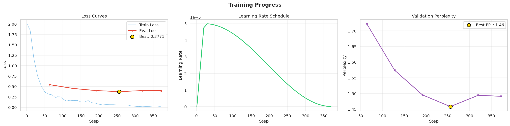
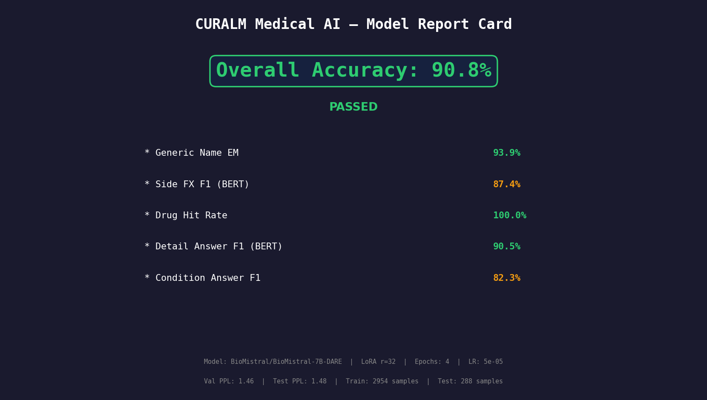

# CuraLM: AI-Driven Personalized Medicine

**CuraLM** is a graduation-project prototype of an AI clinical assistant. It explores whether a biomedical LLM, **BioMistral-7B-DARE**, fine-tuned with **QLoRA** and combined with **retrieval-augmented generation (RAG)**, can suggest drug details and top medications for a given medical condition.

> Graduation project, Computer Science Department, Jamoum University College, **Umm Al-Qura University**. Team of 4.

## Project status

| Part | Status |
|---|---|
| Model work (data prep, QLoRA fine-tuning, FAISS RAG, evaluation) | Done, in one Colab notebook |
| Web UI | **Static mock-up only.** Two HTML pages with no backend |
| Backend / API connecting the UI to the model | **Not part of this repository** |
| Trained adapter weights and FAISS index | Not included (the notebook regenerates them) |

There is no Flask (or any other) server in this repo. The UI pages are design prototypes and do not call the model.

## What the notebook does

`notebook/CuraLM_BioMistral_QLoRA_RAG.ipynb` runs the whole experiment in order:

1. Downloads the Kaggle dataset [drugs-side-effects-and-medical-condition](https://www.kaggle.com/datasets/jithinanievarghese/drugs-side-effects-and-medical-condition) with `kagglehub`.
2. Builds two tasks and splits them into train, validation and test sets:
   - `drug_details`: given a drug and condition, produce the generic name and side effects.
   - `condition_to_top_drugs`: given a condition, list top drugs (by effectiveness, rating and reviews).
3. Fine-tunes `BioMistral/BioMistral-7B-DARE` with 4-bit quantization (BitsAndBytes, NF4) and QLoRA (LoRA r = 32, alpha = 64, 4 epochs, learning rate 5e-5, max length 1536).
4. Builds a **FAISS** index (`IndexFlatIP`) of medical records embedded with `all-MiniLM-L6-v2`.
5. Compares three strategies: RAG for both tasks, no RAG, and a **hybrid** (RAG for `drug_details` only). Retrieval helped drug details and hurt the top-drug task, so the hybrid is the best one.
6. Evaluates with exact match, token F1 and BERTScore, then exports plots to `docs/figures/`.

## Results (from the notebook in this repo)

Evaluation set: 278 drug-detail samples and 10 condition samples. These numbers come from the saved notebook outputs.

**Hybrid strategy (RAG for drug details, no RAG for top drugs)**

| Metric | Score |
|---|---|
| Generic-name exact match | 93.9% |
| Drug-hit rate (condition to top drugs) | 100% |
| Side-effect F1 (BERTScore) | 87.4% |
| Full-answer F1 (BERTScore, drug details) | 90.5% |
| Overall score (strategy comparison cell) | 93.7% |

**Comparison of strategies (overall score)**

| Strategy | Generic-name EM | Drug hit | Overall |
|---|---|---|---|
| Hybrid (best) | 0.939 | 1.00 | 0.937 |
| RAG for both tasks | 0.939 | 0.90 | 0.904 |
| No RAG | 0.626 | 1.00 | 0.840 |

Notes on reading these numbers:

- RAG raised generic-name exact match from 62.6% to 93.9%.
- Side-effect prediction is the weak spot. Token-level F1 is only 17.0% (BERTScore F1 is 87.4%) because side effects are worded inconsistently.
- The final report card in the notebook (`docs/figures/fig09.png`) shows an overall accuracy of **90.8%**, which uses a different weighting than the 93.7% in the strategy comparison. Both are real notebook outputs; the exact weighting is defined in the evaluation cells.
- The condition task has only 10 test samples, so its 100% drug-hit rate is a small-sample result.

| Training progress | Model report card |
|---|---|
|  |  |

More plots (EDA, token lengths, per-task scores, error analysis) are in [`docs/figures`](docs/figures).

## Repository structure

```
├── notebook/
│   └── CuraLM_BioMistral_QLoRA_RAG.ipynb   # data prep, QLoRA training, RAG, evaluation
├── ui/
│   ├── dashboard.html                      # static doctor-dashboard mock-up
│   └── new-diagnosis.html                  # static chat-style mock-up (no model connected)
└── docs/figures/                           # plots exported from the notebook
```

`new-diagnosis.html` links to `treatment-plan.html` and `settings.html`, which are not in the repo, so those links are dead.

## How to run

### The notebook (Google Colab)

1. Open `notebook/CuraLM_BioMistral_QLoRA_RAG.ipynb` in Google Colab and select a **GPU runtime** (a 7B model in 4-bit needs a GPU).
2. Run the cells in order. The notebook installs `faiss-cpu`, `sentence-transformers` and `bert-score` itself, downloads the dataset with `kagglehub`, trains, builds the FAISS index and evaluates. Outputs are written to `/content/curalm_project` (Colab) or `./CURALM_output` (local).
3. The notebook also uses `transformers`, `peft` and `bitsandbytes`; if your runtime lacks them, install them in a first cell: `!pip install transformers peft bitsandbytes accelerate`.

Training time and GPU memory use were not recorded in the repo, so expect a long run.

### The UI mock-ups

There is nothing to install. Open the files directly in a browser:

```bash
# from the repository root
xdg-open ui/dashboard.html        # Linux; use "open" on macOS, or just double-click the file
xdg-open ui/new-diagnosis.html
```

The pages are plain HTML, CSS and JavaScript. Buttons show demo alerts, and the chat page only echoes what you type.

## Tech stack

Python, PyTorch, Hugging Face Transformers, PEFT / QLoRA, BitsAndBytes, FAISS, Sentence-Transformers, BERTScore, Pandas, Matplotlib. UI mock-ups: HTML, CSS, JavaScript.

## Limitations and future work

- The model is not served anywhere yet. A backend (for example FastAPI or Flask) would be needed to connect the UI to the model.
- The evaluation set is small, especially for the condition task.
- The dataset is a public Kaggle collection, not clinical records.
- No explanation module is implemented; the model returns plain answers.

## Disclaimer

CuraLM is an academic prototype. It is not a medical device and must not be used for diagnosis or treatment decisions.

## Author

**Mira Alharbi**, developed with the CuraLM graduation team at Umm Al-Qura University.
